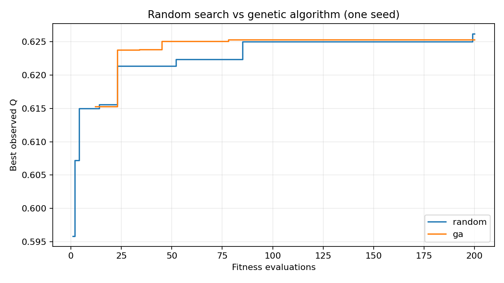

# TelemetryLink — фінальні результати S9

Це результати фактично виконаних команд, не заплановані числа. Базова конфігурація: huffman + dp + greedy scheduler + збережена MLP з частини 9. Вікно 64, поріг 0.5, вага critical 1. Модель не перенавчалася; оцінка TEST з частини 9 не використовувалася для підбору цих експериментів.

Для таблиць 1 і 2 використано 3 seed каналу (1001,1002,1003), по 3 повтори та 1 прогрів на seed/варіант/сценарій. N=9, але незалежних реалізацій каналу лише 3. SD — описовий, без заяви про статистичну значущість. Таблиця 4 використовує seed 425243 з конфігурації та один прогін. Таблиця 5: один seed оптимізатора, одна сесія, по 200 викликів fitness; без заяви про узагальнення.

## 1. DP проти greedy

| Сценарій | Пакувальник | Q mean | Q SD | R mean | Час, мс | Цінність доставленого |
|---|---|---|---|---|---|---|
| calm | dp | 0.674525 | 0.000195 | 1.0000 | 179.9 | 6512.0 |
| calm | greedy | 0.676487 | 0.000149 | 1.0000 | 154.1 | 6512.0 |
| working | dp | 0.666179 | 0.002342 | 0.9756 | 151.5 | 6385.3 |
| working | greedy | 0.669239 | 0.003560 | 0.9789 | 135.1 | 6387.0 |
| emergency | dp | 0.562115 | 0.009143 | 0.3378 | 132.4 | 2846.3 |
| emergency | greedy | 0.561746 | 0.008604 | 0.3378 | 119.0 | 2983.3 |

DP оптимальний для одного фіксованого рюкзака. Q цілого тракту також враховує накладні витрати, час і втрати. Тому вища Q greedy не спростовує коректність DP. Джерело: `EXPERIMENTS-S9/packers.*`.

## 2. Вплив окремих блоків (ablation)

| Сценарій | Варіант | Q mean | ΔQ від baseline | R mean |
|---|---|---|---|---|
| calm | baseline | 0.674460 | +0.000000 | 1.0000 |
| calm | no-compression | 0.725317 | +0.050857 | 1.0000 |
| calm | greedy-packer | 0.676317 | +0.001857 | 1.0000 |
| calm | sequential-scheduler | 0.674441 | -0.000019 | 1.0000 |
| calm | majority-classifier | 0.677347 | +0.002887 | 1.0000 |
| working | baseline | 0.666108 | +0.000000 | 0.9756 |
| working | no-compression | 0.719289 | +0.053181 | 0.9822 |
| working | greedy-packer | 0.669161 | +0.003053 | 0.9789 |
| working | sequential-scheduler | 0.666114 | +0.000006 | 0.9756 |
| working | majority-classifier | 0.671682 | +0.005574 | 0.9833 |
| emergency | baseline | 0.562158 | +0.000000 | 0.3378 |
| emergency | no-compression | 0.608702 | +0.046544 | 0.4733 |
| emergency | greedy-packer | 0.561793 | -0.000366 | 0.3378 |
| emergency | sequential-scheduler | 0.561637 | -0.000521 | 0.3367 |
| emergency | majority-classifier | 0.575229 | +0.013071 | 0.3789 |

Кожен варіант змінює один блок. greedy-packer і sequential-scheduler замінюють відповідний алгоритм, majority-classifier замінює MLP, no-compression вимикає стиснення. Це локальні порівняння з baseline, а не незалежні ефекти, які можна додати між собою. В аварійному каналі no-compression тут покращує Q; MLP теж не гарантує найкращу Q. Джерело: `EXPERIMENTS-S9/ablation.*`.

## 3. Порядок стиснення та шифрування

| Порядок | Сирі біти | Таблиця, біт | Потік, біт | Результат, біт | Коефіцієнт | Точне відновлення |
|---|---|---|---|---|---|---|
| compress-first | 288000 | 4096 | 192496 | 196592 | 1.4650 | true |
| encrypt-first | 288000 | 4096 | 288000 | 292096 | 0.9860 | true |

Результат враховує таблицю й байтове доповнення потоку. AES-CTR не додає padding. Спільні витрати заголовка/salt/nonce/HMAC та канал виключені. Розміри таблиці/число символів для зворотного лабораторного перетворення відомі обом сторонам; це не самодостатній транспортний контейнер. Пакетний формат програми не змінений. Ключ свіжий для запуску, nonce різні для двох схем. Випадковість шифрування може змінити розмір encrypt-first у повторі. Джерело: `EXPERIMENTS-S9/order.csv`.

## 4. Поведінка за втрат

| Сценарій | Q | R | Втрати critical | Поріг | У межах | Втрачено пакетів | Поза бюджетом | ExactRestore |
|---|---|---|---|---|---|---|---|---|
| calm | 0.672423 | 1.000000 | 0.00% | 0% | так | 0 | 0 | true |
| working | 0.662020 | 0.970000 | 3.00% | 5% | так | 3 | 0 | true |
| emergency | 0.554755 | 0.323333 | 67.67% | 20% | НІ | 9 | 81 | true |

**Аварійний сценарій не виконав поріг втрат critical.** ExactRestore=true говорить лише про точність доставлених пакетів. Воно не означає доставку всіх кадрів. Для автоматичного контролю порогу в run використовуйте --strict. Джерело: `EXPERIMENTS-S9/run-*.csv`.

## 5. Random search проти GA

| Алгоритм | Оцінок | Початкова найкраща Q | Підсумкова найкраща Q | Вікно | Поріг | Вага critical |
|---|---|---|---|---|---|---|
| random | 200 | 0.595830 | 0.626204 | 41 | 0.703122 | 2.935309 |
| ga | 200 | 0.615246 | 0.625292 | 40 | 0.501909 | 2.244039 |

Порівнюються однакові бюджети, а не однакові номери поколінь. GA generation 0 уже витратив 12 оцінок, random step 0 — одну. Еліти зберігають попередню оцінку без переоцінки, тому найкраща збережена Q GA не зменшується. Час у Q створює шум: відтворюваність пошуку на детермінованій fitness перевіряють тести, а реальні числові Q можуть відрізнятися. Best означає максимум знайденої Q, а не гарантію проходження порогу втрат. Джерело: `EXPERIMENTS-S9/optimization.*`.

## Перевірки і відтворення

- 342 тести успішні, без пропусків; серед них приймальні та еталонні тести викладача.
- verify: 11/11.
- Release build: 0 помилок, 0 попереджень.
- Чиста копія проєкту збирається та проходить тести за README.
- Контрольні SHA-256 і параметри запусків — `EXPERIMENTS-S9/manifest.json` та вкладені звіти.

Для захисту: код алгоритмів працює, фінальні експерименти виконані; не слід стверджувати проходження всіх порогів якості або результат на прихованому TEST. Додаткові розширення формату, як прогноз залишків/дублювання, до базової реалізації не входять.
